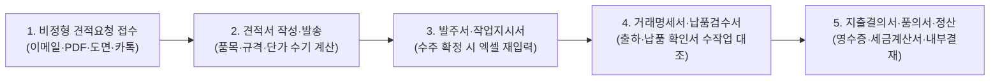
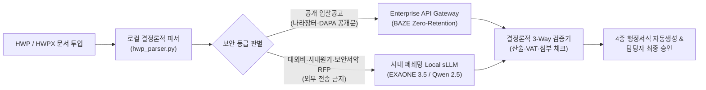

# 2026 DSC 공유대학 AI 실전 프로젝트 챌린지 — 과제 4(Option B) 기초 조사 및 미국·일본 레퍼런스 보고서

- **작성 대상:** 충남대 B팀 (신수하 외 1인)
- **배정 과제:** 과제 4 — **중소기업 반복 행정업무 개선** (예: 문서서식, 업무개선 시연자료)
- **제안 타깃 (Option B):** 대전 대덕산단·대전산단·대덕특구 배후 **B2B 정밀제조 및 연구기자재·기술장비 납품 중소기업**
- **핵심 자동화 대상 문서 체인:** `견적서 → 발주서·작업지시서 → 거래명세서·납품검수서 → 지출결의서·품의서`

---

## 1. 공식 대회 요강 검증 결과 (`officier_notes` 대조)

운영진 배포 문서 2종([사전안내문](file:///Users/woody/DSC_local_problem%20/officier_notes/2026_DSC_AI_%EC%B1%8C%EB%A6%B0%EC%A7%80_%EC%82%AC%EC%A0%84%EC%95%88%EB%82%B4%EB%AC%B8.pdf), [Zoom OT 발표자료](file:///Users/woody/DSC_local_problem%20/officier_notes/2026_DSC_AI_%EC%B1%8C%EB%A6%B0%EC%A7%80_11%EC%9B%9423%EC%9D%BC_Zoom_OT_%EC%B5%9C%EC%A2%85.pdf))의 텍스트 추출 및 전체 슬라이드 이미지 판독을 통해 확인된 공식 조건은 다음과 같습니다.

| 항목 | 확인된 공식 내용 | 출처 확인 여부 |
| :--- | :--- | :--- |
| **주관 및 행사 목적** | DSC 공유대학(대전형) / 우송대학교 앵커사업단 주관, **생성형 AI를 활용해 지역기업 및 지역사회의 문제를 해결하는 프로젝트형 경진대회** | 사전안내문 + OT 슬라이드 1~2 |
| **운영 규모** | 총 8팀 확정 (4개 과제 × 과제별 최대 2팀 배정, 동일 과제 배정 팀도 독립 수행·평가) | OT 슬라이드 3, 7 |
| **과제 4 범위 및 결과물** | **중소기업 반복 행정업무 개선** (예시: 문서서식, 업무개선 자료 / 시연자료). **"AI 활용 결과물은 예시이며, 과제 취지에 맞는 형태로 자유롭게 제작 가능합니다."** | 사전안내문 + OT 슬라이드 6 |
| **일정 및 제출 방식** | 11/24(화)~26(목) 팀별 제작 → **11/26 사전 제출 없음** → **11/27(금) 09:30 대전 호텔선샤인 현장 등록 및 PPT(5~10장) 지참**, 현장 멘토링(팀당 약 30분) 후 14:30~15:00 최종본 제출 | 사전안내문 + OT 슬라이드 4~5 |
| **발표 및 평가 기준** | 팀당 **발표 7분 + 질의응답 3분**. 배점: **문제 이해도 20점 / AI 활용도 30점 / 결과물 완성도 및 활용성 30점 / 창의성 및 발표 20점** (총 100점) | OT 슬라이드 8 *(사전안내문에는 비중 미기재, OT 슬라이드 8에서 배점 확인)* |
| **AI 도구 제한 규정** | 특정 생성형 AI 도구나 플랫폼 사용 제한 규정 없음 (자유 제작) | 양 문서 확인 결과 제한 문구 없음 |
| **시상 (현물)** | 대상 1팀 100만 원 상당, 최우수상 1팀 80만 원 상당, 우수상 2팀 각 30만 원 상당 | 사전안내문 + OT 슬라이드 2, 8 |

> [!NOTE]
> **Option B 적합성 검증:** OT 슬라이드 6의 자유 제작 조항에 따라 과제 4는 특정 업종으로 고정되어 있지 않습니다. 반면 과제 1(소상공인 온라인 홍보), 과제 2(외국인 고객 응대), 과제 3(반복 고객문의 대응)은 주로 소상공인·B2C 접점에 집중되어 있으므로, 과제 4는 **대전 지역 기업형·기술형 중소기업의 내부 행정 문서 파이프라인**을 겨냥할 때 변별력과 **문제 이해도(20점)** 설득력이 극대화됩니다.

---

## 2. 대전 지역 중소기업 현황 및 Option B 타깃 선정 근거

### 2.1 대전 중소기업 거시 통계 및 타깃 포지셔닝의 논리

단순 기업체 수 기준으로 보면 대전 역시 전국 평균과 마찬가지로 **소상공인 및 도·소매업·생활서비스업** 비중이 절대 다수를 차지합니다.

- **대전 전체 중소기업 규모 (2023년 기준, 중소벤처기업부 「중소기업 기본통계」):**
  - **중소기업 수:** **211,134개** (전국 8,298,915개 중 **2.5%**, 전년 205,290개 대비 +2.8%) — [중기부 참고자료 PDF](https://www.mss.go.kr/site/smba/ex/bbs/View.do?cbIdx=86&bcIdx=1061358)
  - **소상공인 수:** **20.1만 개** (전체 중소기업 21.1만 개 중 약 **95%**가 소상공인) — [중기부 지역별 기업수](https://mss.go.kr/site/smba/foffice/ex/statDB/AreaSubStat.do)
  - **중소기업 종사자 수:** **481,130명** (전국 19,117,649명 중 **2.5%**) — [중기부 참고자료 PDF](https://www.mss.go.kr/site/smba/ex/bbs/View.do?cbIdx=86&bcIdx=1061358)
  - **중소기업 매출액:** **70조 1,158억 원** (701,158억 원, 전국 3,301조 2,545억 원 중 **2.1%**) — [중기부 참고자료 PDF](https://www.mss.go.kr/site/smba/ex/bbs/View.do?cbIdx=86&bcIdx=1061358)
- **대전 시도별·업종별(C 제조업 / G 도매·소매업 / M 전문·과학·기술 서비스업) 세부 기업수 (2023년 기준):** **미확인**
  - 본 조사에서 직접 다운로드한 중기부 보도참고자료에는 전국 업종별 비중과 시도별 총계가 분리 수록되어 있으며, 대전 단일 기준의 2023년 업종별 세부 개사 수·구성비는 국가통계포털(KOSIS) `중소기업기본통계 > 시도별·산업별·기업규모별 기업수` (또는 `시도별·산업중분류별·기업규모별 기업수`, 테이블 ID `DT_BR_A001`)에서 지역 필터 `대전`, 산업분류 `C. 제조업`, `G. 도매 및 소매업`, `M. 전문, 과학 및 기술 서비스업`을 선택하여 직접 추출할 수 있습니다. ([KOSIS 통계표 바로가기](https://kosis.kr/statHtml/statHtml.do?tblId=DT_BR_A001&orgId=142))
- **참고 — 전국 업종별 중소기업 분포 (2023년 기준, 중기부 참고자료):**
  - **기업수 비중:** 도·소매업 **26.5%** (2,198,812개), 부동산업 **14.9%** (1,232,980개), 숙박·음식점업 **10.8%** (893,896개), 제조업 **7.4%** (613,696개), 전문·과학·기술업 **4.0%** (333,778개).
  - **매출액 비중:** 도·소매업 **33.5%** (1,105조 4,856억 원), 제조업 **24.8%** (818조 6,334억 원), 건설업 **10.8%** (358조 1,592억 원).

**그렇다면 왜 대전에서 "B2B 정밀제조·연구기자재/기술장비 납품 중소기업(Option B)"을 타깃으로 삼는가?**
1. 과제 1~3이 이미 소상공인·B2C 영역을 다루는 반면, **대전만의 차별화된 산업 특화 축은 '전문·과학·기술 서비스업(R&D)'과 '첨단·정밀 제조업 및 B2B 공급망'**이기 때문입니다.
2. 대덕연구개발특구와 2개 핵심 산업단지(대전산단·대덕산단)를 중심으로 출연연·대학·딥테크 기업에 부품·시약·연구장비를 공급하는 **소규모 B2B 제조·납품 기업**이 밀집해 있으며, 이들은 전담 관리 인력이 1~2명 이하이거나 부재한 상태에서 매 거래마다 반복 문서 체인을 수작업으로 처리하고 있습니다.

### 2.2 대전 지역 특화 산업·산단·특구 근거 지표

| 구분 | 확인된 수치 및 기준 시점 | 출처 |
| :--- | :--- | :--- |
| **대전 법인기업 및 혁신인증** | 본사 소재 법인 **25,705개사** (2020년 기준; 중기업 4.6%, 대기업 0.1%). 인증기업 **2,593개사** (2020년 기준: 벤처 1,531 / 이노비즈 578 / 메인비즈 484) | [DISTEP 한눈에 보는 대전지역 기업통계 PDF](https://www.distep.re.kr/_files/board/20221107/617f9ee066e983876d7391365cba587c.pdf) |
| **대전 특화 업종 집적도** | 전체 사업체 **119,628개사** 중 **전문·과학·기술 서비스업 3,452개사** (2019년 기준, 매출액 전국 대비 5.1%로 전국 3위; 매출 대비 R&D 투자비중 **196.9%** vs 전국 18.72%), **첨단기술업종 1,106개사** (2019년 기준, 전국 대비 3.5%) | [DISTEP PDF](https://www.distep.re.kr/_files/board/20221107/617f9ee066e983876d7391365cba587c.pdf) |
| **대전산업단지** *(대화동·읍내동 제1·2산단)* | 2024년 **1,065개사** (종업원 6,085명) → **2025년 1,083개사** (종업원 8,559명, 내수 3조 4,809억 원, 수출 4억 5,900만 달러) | [대덕구청 산업단지 현황](https://www.daedeok.go.kr/dpt/goContents.do?link=/dpt/dpt06/DPT06040503&menuId=DPT06040503) |
| **대덕산업단지** *(문평동·신일동, 구 3·4산단)* | 2024년 **323개사** (종업원 11,703명) → **2025년 365개사** (종업원 14,901명, 내수 8조 3,508억 원, 수출 26억 9,100만 달러) | [대덕구청 산업단지 현황](https://www.daedeok.go.kr/dpt/goContents.do?link=/dpt/dpt06/DPT06040503&menuId=DPT06040503) |
| **대덕특구 / 전국 연구개발특구** | **대덕특구 코스닥 상장사 64개사** (2025년 말 기준, 2005년 14개사 대비 증가; 시총 상위 10위권 4개사 합산 약 45조 원). 참고로 **전국 6개 연구개발특구 전체**(2024년 말 기준)는 입주기업 **15,671개사**, 매출 **85조 9,000억 원**, 고용 **35만 명**, 누적 연구소기업 **2,339개**(2026년 9월 말 기준). *(대덕특구 단독 입주기업·매출 수치는 미확인)* | [전자신문 특구재단 기고 (2026.10)](https://www.etnews.com/20261015000092) / [유니콘팩토리 (2026.07)](https://www.unicornfactory.co.kr/article/2026071310250517868) |
| **대전 4대 핵심 전략산업** | **바이오헬스, 나노·반도체, 우주항공, 국방** (대덕특구 기반 딥테크·소부장 중소·벤처 생태계) | [유니콘팩토리](https://www.unicornfactory.co.kr/article/2026071310250517868) / [전자신문](https://www.etnews.com/20261015000092) |

### 2.3 국내 중소기업 AI 도입 공백 및 반복 행정 부담 근거

- **중소기업중앙회(KBIZ) 〈중소기업 인공지능 활용의향 실태조사〉** (2024.11.04 보도, 국내 중소기업 300개사 조사):
  - **AI 미적용 비율 94.7%** (적용 기업 **5.3%**), 향후 도입 희망 **16.3%**.
  - 미적용 사유: **"필요성을 못 느낀다"(80.7%)**, "경영에 어떻게 도움이 되는지 모른다"(14.9%), "도입·유지 비용 부담"(4.4%).
  - 도입 장애요인: **기업 맞춤형 응용서비스 부족(64.0%)**, 투자 가능 비용 부족(54.0%), 활용 가능 데이터·기반정보 한계(43.0%).
  - 필요 지원사항: 금융·세제 혜택(84.0%), **산업·기업 규모 맞춤형 성공사례 및 성과 홍보(66.3%)**. ([전북일보 보도](https://www.jjan.kr/article/20241104580219))
- **Dropbox × YouGov 조사** (2025.07.29 보도 — *전체 한국 직장인 대상 조사(n≈600), 중소기업 한정 통계 아님, 벤더 위탁 조사*):
  - 한국 노동자는 행정 업무, 자료 관리, 정기 보고 등 반복적이고 비전략적 업무에 매년 **약 251억 시간**(총 근무시간의 **"거의 절반"**에 해당)을 소비.
  - 응답자의 **68%**가 행정 및 반복 업무에 주당 최대 10시간을, **66%**가 보고서 작성 등 정기 분석 업무에 시간을 사용.
  - 응답자의 **55%**가 **매주 최대 4시간을 절약할 수 있다면 AI를 도입하겠다**고 응답(글로벌 평균 39%). ([ITWorld Korea 보도](https://www.itworld.co.kr/article/4030049/%EB%B0%98%EB%B3%B5-%EC%97%85%EB%AC%B4%EC%97%90-%EA%B0%87%ED%9E%8C-%EC%97%B0%EA%B0%84-251%EC%96%B5-%EC%8B%9C%EA%B0%84%ED%95%9C%EA%B5%AD-%EC%A7%81%EC%9E%A5%EC%9D%B8-%EC%A0%88%EB%B0%98.html))

---

## 3. 반복 행정 문서 파이프라인 (As-Is) 및 병목 지점

대전 대덕산단·유성구 소재 B2B 정밀부품 제조 및 연구기자재 납품 중소기업(5~30인 규모)은 고객(출연연, 대학 연구실, 중견 제조사)의 비정형 요청을 받아 납품·정산에 이르기까지 **동일한 품목·단가·거래처 정보를 4단계 문서에 반복 재입력**합니다.

### 단계별 반복 작업 및 해외·유사 현장 실증 병목

| 단계 | 한국 B2B SME 현장 반복 작업 | 참조 조사·사례에서 확인된 실제 병목 수치 *(대전 현장 개별 측정치는 미확인 — 발표 전 지역 인터뷰로 보완 권장)* |
| :--- | :--- | :--- |
| **1→2. 견적서 (`Quotation`)** | 고객 이메일·PDF 도면·시약 목록을 열어 규격·수량을 엑셀에 옮겨 적고 과거 단가와 마진을 계산해 표준 견적서 양식에 입력 | • **Metalmite (미):** 스프레드시트 기반 RFQ 검토·추적에 주당 최대 **20시간** 소요, 견적 회신 최대 **2주** *(vendor-reported)* • **Paperless Parts 기준:** 수기 라인아이템 1건당 세팅 **2~5분** 소요 *(vendor-reported)* • **Focused on Machining (미, 9인):** 2D PDF 도면 출력 후 수기 메모·ERP 입력으로 견적 리드타임 **5~10영업일** *(vendor-reported)* |
| **2→3. 발주서·작업지시서 (`PO / Work Order`)** | 수주 확정 후 견적서 내용을 그대로 복사해 내부 작업지시서·외주/원자재 발주서에 재입력; 사양 변경 시 전화·종이 수정으로 누락 발생 | • **AI inside 2024 일본 제조업 수주 실태조사(n=329):** **95.2%+**가 종이 서류 거래(`납품서 60.5%`, `청구서 56.5%`, `발주서 51.7%`), **73.3%**가 FAX 수주, **60.4%**가 수기 시스템 재입력 *(vendor-commissioned)* • **しまコスメティック (일):** 매입처 견적→고객 견적→발주서마다 엑셀 수기 재입력 |
| **3→4. 거래명세서·납품검수서 (`Delivery / Inspection`)** | 납품 시 거래명세서와 검수조서를 출력·스캔하고 발주서·청구서 항목(품명·규격·수량)을 육안으로 대조 | • **ケイティケイ (일):** 거래처별 복사용지 납품서 수기 데이터화에 **거래처당 매일 20~30분** 소요 *(vendor-reported)* • **三共ポリエチレン (일):** 월 약 400건 청구서·약 60건 수기 영수증 봉입·발송에 **4~5명이 반나절** 소요 *(vendor-reported)* |
| **4→5. 지출결의서·품의서 (`Expense / Approval`)** | 종이/PDF 매입세금계산서·영수증을 모아 품의서·지출결의서에 기입하고 대표·회계담당자에게 종이 회람·결재 요청 | • **CADDi (일):** 협력 공장에서 오는 월 약 400건의 종이/FAX/이메일 청구서 처리에 **월 30~40시간** 소요 *(vendor-reported)* • **乗富鉄工所 (일):** 종이 품의 회람 지연 및 주간 공정자료 취합 **2시간+**, 내외작 인원표 작성 **8시간+** *(vendor-reported)* |

---

## 4. 미국 레퍼런스 사례 (U.S. Reference Cases)

미국 중소 제조·하드웨어 기업에서는 **"기존 ERP를 통째로 교체하지 않고, 비정형 문서(RFQ·도면·발주·송장)의 읽기·추출·대조 단계만 AI로 자동화하고 최종 승인만 사람이 확인(Human-in-the-Loop)"**하는 패턴이 주류를 이룹니다.

*(참고: 아래 사례의 정량 성과 수치는 모두 각 솔루션 공급사·기업이 공개한 **vendor-reported** 사례 수치입니다.)*

| 기업 / 솔루션 | 대상 SME 프로필 | 해결한 반복 행정 문제 | AI·자동화 메커니즘 | 검증된 성과 지표 *(원문 기준)* | Option B 문서 체인 매핑 |
| :--- | :--- | :--- | :--- | :--- | :--- |
| **Focused on Machining** / *Paperless Parts* | 미국 콜로라도 CNC 정밀가공 공장, **직원 9명** | 2D PDF 도면을 종이로 출력해 가공시간·자재비를 수기 메모한 뒤 ERP에 재입력하여 견적 회신에 **5~10영업일** 소요, 장기 고객 이탈 발생 | 2D/3D CAD 및 도면 지오메트리를 자동 분석해 셋업·가공시간을 추산하고 인터랙티브 디지털 견적서 생성 | • 견적 회신기간 **5~10영업일 → 1~3영업일** (목표 24시간) • 처리량 및 매출 **15~20% 증가** (2019년) • 베타테스트(AI Quote Setup): 라인아이템당 5~15개 파일이 포함된 **견적 패키지 30~40건 처리 시간이 '수 시간' → '30분'**으로 단축 *(vendor-reported)* | **1→2단계: 견적서** (도면·스펙 추출 및 견적 자동화) |
| **Harris Manufacturing Supply & Co.** / *Paperless Parts* | 미국 매사추세츠 오렌지 소재 가족경영 CNC·스위스 선반 가공기업 (1948년 설립) | 생산관리자가 현장 업무에 치여 견적 작성에 최대 **1주일** 소요, 주당 평균 **1건(때로는 0건)** 발송으로 신규 수주 기회 상실 | 도면·3D 모델·고객 메모·기계별 시간당 단가 및 수익성 지표를 단일 플랫폼에 통합하여 견적·가격 책정 자동화 | • 견적 응답 속도 **99% 단축** (최대 1주 → 최소 **1일**) • 견적 업무 시간 **주당 3~5시간 절감** • 주당 견적 발송 **1건 → 7일간 5건** *(vendor-reported)* | **1→2단계: 견적서** (단가 산정·견적 회신 가속) |
| **Metalmite** / *Paperless Parts* | 미국 CNC 밀링·터닝·와이어 EDM 정밀가공기업, 미국 정부 주계약자(Prime), 주당 약 200건 RFQ 접수 | 전화·이메일·방문으로 쏟아지는 월 수백 건의 RFQ를 다수 인원이 스프레드시트로 수기 추적하여 분실·누락·납기 지연 빈발 | Smart RFQ Form으로 누락 없는 요청 접수, 중앙 저장소에서 상태 추적 및 자동 파일 정리 (플랫폼 신규 AI Quote Setup은 라인당 2~5분 걸리던 세팅 시간 **최대 90% 단축** 발표) | • RFQ 수기 관리에 **주당 최대 20시간** 소요되던 혼선 제거 • 대형 견적 리드타임 **최대 2주 → 48시간 보장(48-Hour Turnaround)** *(vendor-reported)* | **1→2단계: 견적서** (다채널 RFQ 통합 접수·추적) |
| **Teguar Computers** / *BILL (AP/AR)* | 미국 노스캐롤라이나 산업·의료용 컴퓨터 제조사, **직원 55명**, 연매출 약 2,700만 달러, **재무팀 2명** | 병원·연구실용 맞춤형 주문 증가로 해외 부품 벤더 지급·추적·현금흐름 관리가 2인 재무팀에 과부하 | NetSuite와 연동해 PDF 송장을 재업로드 없이 BILL로 자동 동기화하고, 지급 승인·국제 송금 추적·현금흐름 리포팅 자동화 | • 행정 업무 **주당 최소 5시간 이상 절감** • 수기 수표 발행을 **월 약 1건** 수준으로 축소 • 벤더 지급 확인 왕복 이메일 대폭 감소 *(vendor-reported)* | **4→5단계: 지출결의·품의·정산** (매입송장·승인·지급 자동화) |
| **AIRCO** / *Ramp Bill Pay* | 미국 산업용 가스·기계부품·실험실 장비 관련 산업서비스 기업 *(vendor-reported)* | 부품·운송·장비 공급업체 다수 거래에서 송장 수기 처리 및 부서별 승인 추적으로 주간 행정 부담 발생 | 맞춤 구매 접수 폼을 통한 PO(발주서) 기반 승인 정책 강제, AI OCR 송장 데이터 추출 및 **2-way / 3-way 매칭(송장-발주-입고 대조)** | • AP(매입채무) 및 지급 처리 시간 **매주 수 시간 절감 ("cut down our AP and payments time by hours each week")** • 전사 지출 실시간 가시성 확보 *(vendor-reported)* | **3→5단계: 발주서-거래명세-지출결의 3-way 대조** |

### 미국 사례 요약 해설

- **Focused on Machining (Paperless Parts):** 직원 **9명** 규모의 소기업도 2D PDF 도면 기반 수기 견적에서 벗어나 스펙 추출·디지털 견적화를 적용하면 회신 속도를 **5~10일 → 1~3일**로 줄이고 매출을 **15~20%** 늘릴 수 있음을 보여줍니다. 특히 Wingman/AI Quote Setup 보도자료에서 동일 대표(Justin Quinn)가 **30~40건의 다파일 견적 패키지 세팅 시간을 수 시간에서 30분으로 줄였다**고 밝힌 점은 "요청 문서 → 견적 초안" 자동화의 직접 근거입니다. ([Focused on Machining 사례](https://www.paperlessparts.com/case-studies/focused-on-machining/), [AI Workflow 보도자료](https://www.paperlessparts.com/press/paperless-parts-cuts-quote-setup-time-by-90-with-new-ai-supported-workflow/))
- **Harris Manufacturing & Metalmite (Paperless Parts):** 소규모 정밀제조사는 견적 담당자가 현장 관리자나 대표를 겸직하기 때문에 "답변이 늦어 수주를 놓치는 문제"가 치명적입니다. Harris는 **주당 3~5시간 절감 및 응답 속도 99% 향상**, Metalmite는 **주당 20시간 비효율 해소 및 48시간 견적 보장**을 달성했습니다. ([Harris 사례](https://www.paperlessparts.com/case-studies/harris-manufacturing-doubles-quote-turnaround-speed-reveals-critical-profit-margin-insights/), [Metalmite 사례](https://www.paperlessparts.com/case-studies/metalmite/))
- **Teguar Computers (BILL):** 산업·의료용 장비라는 점이 대전 타깃과 맞닿아 있으며, **직원 55명·재무 2인 체제**에서 PDF 송장과 ERP(NetSuite) 연동을 통해 매주 **5시간 이상**을 절약한 현실적 모델입니다. ([Teguar 사례](https://www.bill.com/case-study/teguar-computers))
- **AIRCO (Ramp Bill Pay):** 구매 요청 폼과 PO-송장 자동 대조(3-way matching)로 발주부터 지출 승인까지의 누락을 차단한 사례입니다. ([Ramp 제조업 AP 가이드](https://ramp.com/blog/bill-pay-guides/manufacturing))
- **참고(보조 맥락 — NIST MEP / 비문서·비미국 사례 구분):** NIST MEP 기반 소기업 AI 가이드([americanmachine.ai](https://www.americanmachine.ai/ai-for-small-manufacturers))는 소규모 공장이 센서·비전 검사보다 **도면 읽기·주문 재입력 등 반복 서류 작업부터 AI를 적용해야 ROI가 빠르다**고 권고합니다(부수 사례로 Purdue MEP와 함께 AI 스케줄링을 도입해 초과근무를 50시간→사실상 0으로 줄인 *Dayton-Phoenix*를 소개). 또한 검색 과정에서 자주 인용되는 Esker의 *Accord Healthcare*(월 140시간 절감) 및 *Simon*(직원 4,000명, 처리속도 80% 단축)은 **유럽 대·중견기업 사례**이므로 본 보고서의 미국 SMB 표에서는 제외했습니다.

---

## 5. 일본 레퍼런스 사례 (Japan Reference Cases)

일본은 한국 중소기업과 **'엑셀·종이·도장(한코)·FAX 중심의 B2B 거래 관행'** 및 **'고령화·인력난'** 구조가 거의 동일합니다. 일본 경제산업성(METI) 중심의 중소기업 DX 흐름 속에서 **① AI-OCR 전표 인식(バクラク·DX Suite)** 과 **② 노코드 원클릭 문서 연계(kintone)** 모델이 중소 제조·유통업 현장에서 검증되었습니다.

*(참고: 아래 사례의 정량 성과 수치는 모두 각 솔루션 공급사·도입기업이 공개한 **vendor-reported** 수치입니다.)*

| 기업 / 솔루션 | 대상 기업 프로필 | 해결한 반복 행정 문제 | AI·자동화 메커니즘 | 검증된 성과 지표 *(원문 기준)* | Option B 문서 체인 매핑 |
| :--- | :--- | :--- | :--- | :--- | :--- |
| **キャディ株式会社 (CADDi)** / *LayerX バクラク請求書* | 가공품 수발주 제조DX 플랫폼 (전국 중소 공장과 거래) | 전국 영세 공장(町工場)에서 **우편·FAX·이메일로 월 약 400매** 도착하는 종이 청구서 입력·분개에 월말·월초 10영업일 야근 발생 | AI-OCR로 비정형 청구서를 자동 데이터화하고, 과거 분개(계정과목) 데이터를 AI가 자동 학습·생성해 비경험자도 날짜·금액만 검수 | • 월간 청구서 처리 시간 **30~40시간 → 3~4시간 (약 1/10 단축)** • 1인 집중 탈속인화 및 잔업 감축 *(vendor-reported)* | **4→5단계: 매입 청구서·지출결의·회계 연동** |
| **三共ポリエチレン株式会社** / *LayerX バクラク請求書発行* | 일본 제조업 중소기업 (복수 거점 운영) | 본사에서 **월 약 400건 청구서 + 약 60건 수기 영수증** 출력·봉입·발송에 **4~5명이 반나절** 소요, 우편비 월 약 9만 엔, 재발행 시 본사-거점 간 확인 번거로움 | 품명·규격이 긴 제조업 서식을 A4 세로 표준 틀에 맞추고 거래처별 발송방식(이메일/우편) 자동 구분 및 전자발송 전환 | • 청구서·영수증 **약 80% 전자발송 전환** • 우편비용 **월 약 9만 엔 → 약 2만 엔 수준**으로 절감 • 잔여 봉입 작업 **4~5명 반나절 → 1명 1~2시간**으로 단축 *(vendor-reported)* | **4단계: 거래명세서·청구서 자동 생성 및 발송** |
| **三田理化工業株式会社** / *Cybozu kintone* | **의료기기·이화학(실험실) 기기·제제기기 제조사** (1949년 창업, PC 보유 사원 약 30명) | 고객·영업·수리 이력이 메일·복수 엑셀에 분산, 인수인계 자료는 A3 1장뿐; 수리·납품 이력을 여러 엑셀 시트에 중복 재입력 | 영업·납품·소모품·수리 부서가 공유하는 단일 고객·안건·납품처 마스터 DB를 노코드로 구축하여 1회 입력 데이터를 후속 공정에서 재활용 | • **상담 준비 시간 1건당 1.5시간 → 5분 미만**으로 단축 • 복수 엑셀 시트 중복 기재 제거 및 오기입 감소 • 사후 수리 위주에서 **예방 점검 비율 28% → 50% 이상**으로 상승 *(vendor-reported)* | **1→4단계: 고객·납품이력 통합 DB & 재입력 제거** *(실험·의료장비 제조사로 대전 모델과 직결)* |
| **株式会社乗富鉄工所** / *kintone + PrintCreator* | 후쿠오카 야나가와시 소재 수문 등 수리시설·철공 제조사 (1948년 창업) | 종이 품의서 회람이 도중에 멈추거나 분실됨; 주간 공정회의 자료 취합에 **매주 2시간+**, 10명 영업담당 구두·종이 취합해 내외작 인원표 작성에 **8시간+**(2개월에 1회만 판단 가능) | kintone으로 실시간 진척·수주 관리 DB를 구축하고, **PrintCreator**로 기존 엑셀과 유사한 PDF 수주관리표·견적서·청구서를 원클릭 출력 (QR코드 포함) | • 매주 **2시간+ 회의자료** 및 **8시간+ 인원표** 작성 → **원클릭·실시간 확인** • 내외작 의사결정 주기 **2개월 1회 → 주 1회** 단축 • 자사 브랜드 고객용 **견적서·청구서** PDF 원클릭 생성 *(vendor-reported)* | **2→3단계 & 4→5단계: 수주표·품의서·견적서·청구서 원클릭 출력** |
| **株式会社しまコスメティック** / *kintone + krewData + k-Report* | 화장품·건강식품 기획·자사공장 제조 중소기업 | 영업담당이 `매입처 견적 의뢰 → 고객 견적서 작성 → 매입처 발주서 작성`마다 고객·매입처·금액 정보를 매번 엑셀에 수기 재입력 | **krewData**로 `매입처견적 DB → 고객견적 DB → 발주관리 DB` 간 데이터 자동 전기를 구현하고, **k-Report**로 버튼 한 번에 발주서·견적서 서식 출력 | • 매입처 정보·견적 금액 반복 재입력 수작업 제거 및 대폭 공수 절감, 대응 누락 방지 *(정량 시간 미기재, vendor-reported)* | **1→3단계: 매입견적→고객견적→발주서 자동 전기** |
| **ケイティケイ株式会社 (KTK)** / *AI inside DX Suite* | 1971년 설립, 리사이클 토너 등 오피스용품 제조·공급 (법인 고객 약 12,000사) | 본사 콜센터 일 약 200건 주문서 및 1일 5~80매 복사용지 납품서가 FAX·종이로 도착해 수기 입력과 1년 보관·폐기 부담 | 복합기 수신 FAX 이미지 및 종이 납품서를 **DX Suite AI-OCR**로 판독, 특정 문자 추출·가공 후 CSV 출력 → 사내 툴로 기간시스템 자동 등록 | • **납품서 데이터화 업무 월 90시간 절감** (주요 9개사 기준 **1사당 일 20~30분 → 수 분**으로 단축) • 청구서-외상매입금 자동 대조 활용 *(vendor-reported)* | **3→4단계: 주문서·납품서·청구서 AI-OCR 추출 및 대조** |
| **株式会社アイケイ (IK)** / *AI inside DX Suite* | 잡화·식품·화장품 기획·제조·도매(메이커 벤더) | 거래처 50여 개 거점 등에서 양식이 제각각인 비정형 수주표가 **주간 수천 매**(전체의 약 1/3이 FAX) 도착해 약 10명이 상시 수기 CSV 입력 | 복합기 임시보관 FAX·문서 이미지를 사내 분류 후 **DX Suite**로 비정형 판독 → CSV 변환 → 화면 육안 검수 후 DB 적재 | • 하루 종일 걸리던 수주 입력 작업 시간을 **절반 이하(>50% 단축)**로 압축 *(vendor-reported)* | **2→3단계: 비정형 수주·발주 문서 AI-OCR 입력 자동화** |
| **NECネッツエスアイ** *(대규모 참고사례)* / *AI inside DX Suite* | ICT 인프라 구축 대기업 조달본부 (연간 약 3,000사 발주, 연간 관련 장표 약 14만 건) | 노무 발주의뢰서·견적서·구매사양서를 전량 종이로 수기 대조·입력(업무의 약 30%가 종이 서류 원인) | RPA + DX Suite(Elastic Sorter)로 의뢰서와 견적서 PDF를 자동 결합·판독 후 **회사명·발주금액·견적서 번호 일치 여부 자동 판정** | • 연간 처리 공수 **5,267시간 → 3,107시간 (2,160시간 / 약 41% 절감)** *(기사 헤드라인은 '59% 공수 삭감'으로 표기했으나 본문 수치 5,267→3,107 기준 실제 감소율은 41.0%)* • 우편 개봉(4명×일 1시간) 및 종이 보관 창고비 절감 *(vendor-reported)* | **2→3단계: 견적서-발주의뢰서 자동 대조(Cross-Check)** |

### 일본 현장 실태조사 데이터 (보조 근거)

- **AI inside 〈제조업 수주업무 종이서류 이용실태 조사〉** (2024년 6월 조사, 2024.08.29 발표, 제조업 수주업무 담당자 **329명** 대상 — *vendor-commissioned survey*):
  - **95.2% 이상**이 여전히 종이 서류 거래 (`납품서 60.5%`, `청구서 56.5%`, `발주서 51.7%`).
  - 종이 서류 거래 기업의 **73.3%**가 FAX로 서류를 수령하며, **60.4%**가 수주 시스템에 **수기 입력** 중.
  - FAX 수령 담당자의 **88.4%**가 "FAX 거래를 중단하고 싶다"고 응답했으나, **"거래처가 FAX를 쓰기 때문에 전환할 수 없다"(63.0%)**가 1위 장벽.
  - 수기 입력 담당자의 **88.1%**가 **데이터 입력 자동화 서비스 도입을 희망**. ([PR TIMES 보도자료](https://prtimes.jp/main/html/rd/p/000000165.000024457.html))

---

## 6. 레퍼런스 → 우리 팀(충남대 B팀) 시연 기능 매핑표

심사기준의 핵심인 **AI 활용도(30점)** 와 **결과물 완성도 및 활용성(30점)** 을 동시에 확보하기 위해, 위 6대 해외 사례의 검증된 메커니즘을 우리 팀의 시연 프로토타입/서식 패키지에 다음과 같이 1:1로 이식합니다.

| 차용할 해외 레퍼런스 메커니즘 | 원출처 사례 | 우리 팀 데모·문서서식 적용 기능 | 대전 SME 실무 효과 |
| :--- | :--- | :--- | :--- |
| **비정형 요청(이메일·PDF·스캔) AI 파싱 & 누락 체크** | Paperless Parts (*Focused on Machining*, *Metalmite*) | **[Step 1 입력기]** 고객 발주 이메일·카톡·PDF 시방서를 붙여넣거나 업로드하면 LLM이 `품명·규격·수량·납기·특이사항` JSON을 추출하고, 누락 항목(예: 부가세 포함 여부, 도장/재질 스펙)을 자동 플래깅 | 수주 전 스펙 확인·질의 왕복 시간 단축 (2~5분/건 → 수십 초) |
| **단일 원천 데이터(Single Source of Truth) 자동 전기** | kintone (*三田理化工業*, *しまコスメティック*) | **[Step 2 원클릭 문서 체인]** 추출된 1개 JSON/DB 레코드를 기반으로 **① 표준 견적서 → ② 발주서·작업지시서 → ③ 거래명세서·납품검수서 → ④ 내부 품의·지출결의서** 4종 서식에 자동 바인딩 (한 번 입력, 4번 활용) | 엑셀 간 복사·붙여넣기 및 품목·수량·단가 오기입 원천 차단 |
| **기존 양식 레이아웃 유지 PDF/문서 출력** | kintone + PrintCreator (*乗富鉄工所*), *三共ポリエチレン* | **[Step 3 현장 호환 서식]** 중소기업 대표·거래처가 낯설어하지 않도록 한국 B2B 실무에서 바로 쓰는 A4 1페이지 표준 서식 레이아웃(공급가액/부가세/합계, 검수 서명란, 결재선) 그대로 생성·다운로드 | KBIZ 조사 1위 장벽('필요성·활용법 모름', 현장 거부감) 극복 |
| **다문서 크로스체크 & Human-in-the-Loop 검수** | Ramp (*AIRCO*), LayerX (*CADDi*), AI inside (*NEC*) | **[Step 4 이상탐지·인간검수]** 견적서-발주서-거래명세서(세금계산서) 간 단가·수량·총액 불일치(3-way mismatch)를 AI가 경고 표시하고, 담당자는 **검수·승인 버튼만 클릭** | 정산 불인정·오청구·중복지급 예방 및 비숙련자도 즉시 투입 가능 |

---

## 7. PPT 바로 붙여넣기용 요약 슬라이드 초안 (한국어 1장)

> **슬라이드 제목:** [해외 벤치마크] 미국·일본 SME는 이미 '반복 행정 문서 AI 자동화'로 시간과 비용을 줄이고 있습니다

- **핵심 메시지:** 거창한 ERP 교체가 아니라, **비정형 요청(PDF·이메일·FAX) 추출 + 문서 간 자동 연동 + 사람 최종 검수**만으로 소규모 제조·납품기업이 즉각적인 성과를 거두고 있음 *(각 공급사·기업 공개 사례 기준)*.

- **🇺🇸 미국 (견적·발주·지출 자동화)**
  1. **Focused on Machining (Paperless Parts · 직원 9명 CNC 가공):** 도면 기반 수기 견적을 AI 디지털 견적으로 전환 → 견적 회신 **5~10일 → 1~3일**, 매출·처리량 **15~20% 증가** (AI 세팅 시간 최대 **90%** 단축).
  2. **Teguar Computers (BILL · 직원 55명 산업/의료용 컴퓨터 제조):** 2인 재무팀의 송장·ERP 연동을 자동화 → **주당 최소 5시간 이상** 행정시간 절감, 수기 수표 월 1건 수준 축소.
  3. **AIRCO (Ramp Bill Pay · 산업서비스·장비):** 구매 요청–발주(PO)–송장 자동 대조 적용 → 매입채무·지급 처리 시간 **매주 수 시간 절감**.

- **🇯🇵 일본 (송장·노코드 워크플로우·AI-OCR 수주)**
  1. **CADDi (LayerX 바쿠라쿠 · 제조 공급망):** 전국 공장의 종이·FAX 청구서 월 400건을 AI-OCR·자동분개 처리 → **월 30~40시간 → 3~4시간 (1/10 단축)**.
  2. **三田理化工業 (kintone · 직원 ~30명 의료/이화학 기기 제조):** 분산된 엑셀·A3 인수인계를 단일 DB로 통합 → 상담 준비 **1.5시간 → 5분**, 복수 엑셀 중복 입력 제거.
  3. **KTK / 아이케이(IK) (AI inside DX Suite · 제조/도매):** 비정형 FAX 주문서·납품서 AI-OCR 자동화 → KTK 납품서 **월 90시간 절감**, 아이케이 수주 입력 시간 **50% 이상 단축**.

- **대전 적용 시사점 (우리 팀 솔루션 방향):** 대전 **대덕산단·대전산단·대덕특구 배후 B2B 정밀제조 및 연구기자재 납품기업**은 **1회 입력 → 4종 문서(견적·발주·거래명세/검수·품의) 자동 변환 및 3-way 검수** 모델에 가장 최적화되어 있음.

---

## 8. 전체 출처 목록 (HTTP 200 검증 완료 원문 URL)

### 대회 공식 문서 (로컬 워크스페이스)
1. [2026_DSC_AI_챌린지_사전안내문.pdf](file:///Users/woody/DSC_local_problem%20/officier_notes/2026_DSC_AI_%EC%B1%8C%EB%A6%B0%EC%A7%80_%EC%82%AC%EC%A0%84%EC%95%88%EB%82%B4%EB%AC%B8.pdf)
2. [2026_DSC_AI_챌린지_11월23일_Zoom_OT_최종.pdf](file:///Users/woody/DSC_local_problem%20/officier_notes/2026_DSC_AI_%EC%B1%8C%EB%A6%B0%EC%A7%80_11%EC%9B%9423%EC%9D%BC_Zoom_OT_%EC%B5%9C%EC%A2%85.pdf)

### 대전 지역 통계 및 국내 중소기업 실태
3. 중소벤처기업부, 지역별 기업수(소상공인·중소기업, 2023년 기준): https://mss.go.kr/site/smba/foffice/ex/statDB/AreaSubStat.do
4. 중소벤처기업부, 「2023년 기준 중소기업 기본통계 결과 발표」 보도자료 및 참고자료 PDF (2025.08.29): https://www.mss.go.kr/site/smba/ex/bbs/View.do?cbIdx=86&bcIdx=1061358
5. 국가통계포털(KOSIS), 중소기업기본통계(시도별·산업중분류별·기업규모별 기업수 `DT_BR_A001`): https://kosis.kr/statHtml/statHtml.do?tblId=DT_BR_A001&orgId=142
6. 대전광역시 대덕구청, 대전산업단지·대덕산업단지 연도별 현황: https://www.daedeok.go.kr/dpt/goContents.do?link=/dpt/dpt06/DPT06040503&menuId=DPT06040503
7. 대전과학산업진흥원(DISTEP), 《한눈에 보는 대전지역 기업통계》 요약 PDF (2019~2020년 기준): https://www.distep.re.kr/_files/board/20221107/617f9ee066e983876d7391365cba587c.pdf
8. 전자신문, 정희권 연구개발특구진흥재단 이사장 시론 (2026.10.15): https://www.etnews.com/20261015000092
9. 유니콘팩토리, 2026 딥테크 성과교류회 및 특구 통계 보도 (2026.07.13): https://www.unicornfactory.co.kr/article/2026071310250517868
10. 전북일보, 중소기업중앙회 〈중소기업 인공지능 활용의향 실태조사〉 보도 (2024.11.04): https://www.jjan.kr/article/20241104580219
11. ITWorld Korea, 드롭박스×유고브 한국 직장인 반복업무 조사 보도 (2025.07.29): https://www.itworld.co.kr/article/4030049/%EB%B0%98%EB%B3%B5-%EC%97%85%EB%AC%B4%EC%97%90-%EA%B0%87%ED%9E%8C-%EC%97%B0%EA%B0%84-251%EC%96%B5-%EC%8B%9C%EA%B0%84%ED%95%9C%EA%B5%AD-%EC%A7%81%EC%9E%A5%EC%9D%B8-%EC%A0%88%EB%B0%98.html

### 미국 레퍼런스 사례
12. Paperless Parts — Focused on Machining Case Study: https://www.paperlessparts.com/case-studies/focused-on-machining/
13. Paperless Parts — Harris Manufacturing Case Study: https://www.paperlessparts.com/case-studies/harris-manufacturing-doubles-quote-turnaround-speed-reveals-critical-profit-margin-insights/
14. Paperless Parts — Metalmite Case Study: https://www.paperlessparts.com/case-studies/metalmite/
15. Paperless Parts — AI-Supported Quote Setup Workflow Press Release: https://www.paperlessparts.com/press/paperless-parts-cuts-quote-setup-time-by-90-with-new-ai-supported-workflow/
16. BILL — Teguar Computers Case Study: https://www.bill.com/case-study/teguar-computers
17. Ramp — AP Automation in Manufacturing (incl. AIRCO case): https://ramp.com/blog/bill-pay-guides/manufacturing
18. American Machine (보조 맥락, NIST MEP / Dayton-Phoenix 인용): https://www.americanmachine.ai/ai-for-small-manufacturers

### 일본 레퍼런스 사례
19. PR TIMES (LayerX), 캐디(CADDi) 바쿠라쿠 청구서 도입사례 (2022.01.14): https://prtimes.jp/main/html/rd/p/000000103.000036528.html
20. DX Port (LayerX 요약), 삼공폴리에틸렌(三共ポリエチレン) 바쿠라쿠 청구서발행 도입사례: https://dxport.jp/cases/bakuraku-01e311967c/
21. Cybozu kintone 공식 사례, 미타리카공업(三田理化工業): https://kintone-sol.cybozu.co.jp/cases/mitarika.html
22. Cybozu kintone 공식 사례, 노리토미철공소(乗富鉄工所): https://kintone-sol.cybozu.co.jp/cases/noridomi.html
23. Toyokumo PrintCreator 공식 사례, 노리토미철공소(乗富鉄工所): https://www.kintoneapp.com/case/noritetsu
24. Comdec AI Lab, 시마코스메틱(しまコスメティック) kintone 매입·견적·발주 자동화 사례: https://www.comdec.jp/comdeclab/shimacosmetic-01/
25. AI inside DX Suite 공식 사례, 케이티케이(ケイティケイ): https://dx-suite.com/casestudy/manufacturing/uservoice59/
26. AI inside DX Suite 공식 사례, 아이케이(株式会社アイケイ): https://dx-suite.com/casestudy/other/uservoice2/
27. AI inside DX Suite 공식 사례, NEC네츠에스아이(대규모 조달 참고사례): https://dx-suite.com/casestudy/other/uservoice39/
28. PR TIMES (AI inside), 제조업 수주업무 종이서류 이용실태 조사(n=329, 2024.08.29): https://prtimes.jp/main/html/rd/p/000000165.000024457.html

---

## 9. 연구소·방산·기술 중소기업 정보유출 방지를 위한 On-Premise Local sLLM 타당성, 비용·재시도 기회비용 및 도입 결론

대전 대덕연구개발특구 및 방산·정밀제조 공급망에 속한 중소기업과 연구소기업은 **방위사업청 보안서약 대상 제안요청서(RFP)·국방규격서, 출연연 시험성적서, 사내 원가산출내역서·단가표** 등 민감 기밀 문서를 상시 다룹니다. 따라서 외부 퍼블릭 클라우드 LLM에 원문을 그대로 업로드하는 방식은 정보유출 위험으로 현장 도입이 불가능합니다. 본 절에서는 **① 국내·해외 오픈소스 Local sLLM 기반 구동 가능성**, **② 사내 컴퓨팅 자원 비용 및 실패·재시도 기회비용 산출(시나리오 추정)**, **③ 도입 당위성과 이점 결론**을 정리합니다.

### 9.1 국내·해외 오픈소스 Local sLLM으로도 가능한가? (아키텍처 분리 원칙)

**결론: 가능합니다.** 단, 소형 로컬 LLM(7B~32B 파라미터)에게 "바이너리 파일 해독 + 복잡한 부가세 산술 + A4 서식 렌더링"까지 전부 맡기면 실패율이 급증합니다. 우리 팀의 파이프라인(`pipeline/hwp_parser.py` + `pipeline/baze_pipeline.py`)은 **결정론적 코드 영역**과 **LLM 추론 영역**을 명확히 분리(Decoupling)했기 때문에 소형 로컬 모델에서도 안정적으로 동작합니다.

| 처리 단계 | 담당 엔진 | Local sLLM 부담 여부 | 기술적 근거 |
| :--- | :--- | :--- | :--- |
| **1. HWP 5.0 / HWPX 파싱** | 결정론적 코드 (`struct`·`zlib`·`XML`) | **LLM 미사용 (0 토큰)** | OLE2 바이너리 및 OWPML 표 구조를 코드로 100% 무손실 선추출 |
| **2. 핵심 필드·리스크 JSON 추출** | **Local sLLM** (`Ollama` / `vLLM`) | **유일한 AI 추론 구간** (~3,000 입력 → ~800 출력 토큰) | OpenAI 호환 API + JSON 스키마 제약 디코딩(`response_format` / GBNF)으로 고정 스키마만 채움 |
| **3. 단가·세액 산술 및 3-Way 검증** | 결정론적 코드 (`normalize_and_crosscheck`) | **LLM 미사용 (산술 오류 0%)** | 소형 LLM이 틀리기 쉬운 `수량×단가`, `VAT 10%`, `3-Way 일치 검증`을 코드가 강제 재계산·검증 |
| **4. 4종 한국형 서식 출력** | 템플릿 바인딩 (`HTML/CSS/PDF`) | **LLM 미사용 (서식 붕괴 0%)** | 단일 JSON 원천을 표준 A4 서식에 직접 매핑 |

#### 국내·해외 오픈웨이트 Local sLLM 적용 후보 비교

| 구분 | 대표 모델명 | 권장 양자화·VRAM | 한국어 공문·JSON 처리 특성 | 적합한 사내 배치 환경 |
| :--- | :--- | :--- | :--- | :--- |
| **국내 오픈웨이트** | **LG AI Research `EXAONE 3.5` (7.8B / 32B)** | 7.8B(Q4): ~6GB / 32B(Q4): ~20GB | 한국어 공문서·법령·지시이행 및 JSON 구조화 성능이 동급 최상위권 | 7.8B: 단일 16GB GPU PC / 32B: 24~48GB GPU 워크스테이션 |
| **국내 오픈웨이트** | **Upstage `SOLAR-10.7B`** / **야놀자 `EEVE-Korean-10.8B`** | Q4_K_M: ~7~8GB | 한국어 어휘·문맥 이해도가 높고 12~16GB VRAM 환경에서 빠른 추론 가능 | 사내 공용 업무용 GPU PC 1대 |
| **해외 오픈소스** | **Alibaba `Qwen 2.5` (7B / 14B / 32B, Apache 2.0)** | 14B(Q4): ~10GB / 32B(Q4): ~20GB | 구조화 JSON 출력 안정성 및 다국어(한국어 포함) 긴 문맥 추출 성능 우수 | 14B: RTX 4070 Ti Super~4090 / 32B: 2×GPU 서버 |
| **해외 오픈소스** | **Meta `Llama 3.1 / 3.3` (8B)** / **Google `Gemma 2 / 3` (9B~27B)** | 8B~12B(Q4): ~6~9GB | 범용 JSON 추출 및 온프레미스 생태계(`Ollama`, `vLLM`) 호환성 우수 | 일반 사내 PC·워크스테이션 |

#### 보안 등급별 하이브리드 라우팅 (Hybrid Security Routing)

실제 [baze_pipeline.py](file:///Users/woody/DSC_local_problem%20/pipeline/baze_pipeline.py)는 `--base-url http://localhost:11434/v1 --model exaone3.5:7.8b` 옵션만으로 **코드 수정 없이 즉시 사내 폐쇄망 Ollama/vLLM 로컬 서버로 전환**되도록 구현되어 있습니다.

---

### 9.2 사내 컴퓨팅 자원 비용 계산 및 실패·재시도 기회비용 분석 (설계 시나리오 추정)

중소기업(5~30인 규모)이 사내 GPU 자원을 직접 구축·운영할 때의 **설비 감가상각비(CapEx), 전기요금(OpEx), 실패·재시도 시간 및 인적 검수 기회비용**을 보수적 기준으로 산출하면 다음과 같습니다. *(아래 수치는 한국 B2B 중소기업 월 40건 처리, 엔지니어·관리자 시급 35,000원 가정 기반의 시나리오 추정치입니다.)*

#### ① 사내 컴퓨팅 자원 하드웨어(CapEx) 및 전력(OpEx) 비용

| 사내 인프라 구성 | 권장 탑재 모델 | 초기 구축비(CapEx) | 36개월 감가상각(월) | 전력 OpEx (일 4h × 22일 기준) | 월 총 인프라 비용 |
| :--- | :--- | :--- | :--- | :--- | :--- |
| **옵션 A: 단일 GPU 업무 PC** *(RTX 4070 Ti Super 16GB~RTX 4090 24GB 1대)* | `EXAONE 3.5 7.8B` 또는 `Qwen 2.5 14B (Q4)` | **약 250만~420만 원** *(기존 PC 업그레이드 시 ~150만~250만 원)* | **약 6.9만~11.7만 원/월** | 평균 0.4kW × 88h ≈ 35kWh → **약 6,000~8,000원/월** *(건당 ~20초 추론 전력비 1원 미만)* | **약 7.5만~12.5만 원/월** |
| **옵션 B: 전용 듀얼 GPU 미니서버** *(2× RTX 4090 48GB 또는 RTX 6000 Ada)* | `EXAONE 3.5 32B` 또는 `Qwen 2.5 32B` | **약 800만~1,100만 원** | **약 22.2만~30.5만 원/월** | 평균 0.8kW × 88h ≈ 70kWh → **약 1.5만~2.5만 원/월** | **약 23.7만~33.0만 원/월** |

#### ② Local sLLM 실패·재시도 가능성과 그에 따른 기회비용 계산

소형 로컬 LLM을 실제 업무에 투입할 때 발생할 수 있는 실패 유형은 크게 **3가지**로 분해되며, 각 실패가 유발하는 시간·비용 손실은 아키텍처 설계에 따라 극명하게 갈립니다.

1. **JSON 문법·키 누락 실패 (가정 1차 실패율 $p = 15\%$):**
   - `pipeline/baze_pipeline.py`는 스키마 검증(`_extract_json_payload`) 실패 시 에러 원인을 프롬프트에 역주입하는 **자동 재시도 루프(`--max-retries 3`)**를 내장했습니다.
   - 기하분포 기댓값 기준 문서당 평균 LLM 호출 횟수는 $1 / (1 - p) = 1 / 0.85 \approx 1.18\text{회}$이며, 3회 자동 재시도 후에도 스키마가 완전히 깨질 잔여 확률은 $0.15^3 \approx 0.34\%$에 불과합니다.
   - 재시도로 인한 추가 GPU 연산 시간은 **건당 약 3~5초(월 40건 기준 총 2~3분, 전력비 수십 원 수준)**로 사실상 **무시 가능한 수준**입니다.
2. **단가·부가세·합계 산술 환각 (소형 모델 단독 시 ~20~30% 발생 가능):**
   - 우리 파이프라인에서는 `normalize_and_crosscheck()`가 모든 수량×단가, 10% 부가세, 3-Way 일치 검증을 결정론적 Python/JS 코드로 강제 덮어쓰기 때문에 **산술 실패로 인한 재시도·기회비용은 0원**입니다.
3. **문맥 오인식·항목 보정이 필요한 인적 수정(Human-in-the-Loop, 건당 3~4분):**
   - 공고 조건 해석 미흡이나 세부 품목명 다듬기 등 사람 확인이 필요한 경우(보수적으로 전체 건의 20%에서 추가 3분 수정 발생 가정 시, 평균 검수·수정 시간 **건당 약 4~5분**), 웹 UI의 **단일 원천 수정(Single Source Edit)**을 통해 1회만 고치면 4종 문서가 일괄 갱신되므로 월 40건 기준 인건비 기회비용은 **약 9.3만~11.7만 원/월**(2.7~3.3시간 × 35,000원/h)입니다.

#### ③ 총소유비용(TCO) 및 기회비용 종합 비교 (월 40건 처리 기준 시나리오)

| 비교 대안 | 월 소요 인력 시간 | 월 인건비·재시도 기회비용 | 월 하드웨어·전력 비용 | 월 총비용 합계 | 핵심 리스크 및 비고 |
| :--- | :--- | :--- | :--- | :--- | :--- |
| **1. 기존 수작업 (As-Is)** | **60~80시간** *(건당 90~120분 × 40건)* | **210만~280만 원** | 0원 | **210만~280만 원/월** | 연구원·실무자 본업 이탈 기회비용 + 견적 지연으로 수주 탈락 위험 |
| **2. 무검증 자작 LLM** *(파서·교차검증 없이 프롬프트만 사용)* | **20~30시간** *(건당 30~45분 재검산)* + 초기 시행착오 | **70만~105만 원** *(+ 개발자 삽질 1~2개월 ≈ 560만~1,120만 원)* | ~10만 원 *(단일 GPU)* | **80만~115만 원/월** *(초기 매몰비용 별도)* | 산술·HWP 파싱 오류 누적 시 현장 불신으로 시스템 폐기 위험 높음 |
| **3. 본 하이브리드 파이프라인** *(옵션 A: 단일 RTX GPU + 자동재시도 + 3-Way 검증)* | **2.7~3.3시간** *(건당 4~5분, 재시도 포함)* | **약 9.5만~11.7만 원** | **약 7.5만~12.5만 원** *(감가상각+전기세)* | **약 17만~24만 원/월** | **월 순절감액 약 186만~263만 원 (시간 95%↓)**, GPU 투자비 **약 1.5~2개월 내 회수** |

---

### 9.3 결론: 본 시스템 도입의 중요성 및 전략적 이점

대전의 대덕특구 연구소기업·방산 벤처·정밀제조 중소기업 현장에서 본 시스템의 도입은 단순한 문서 작성 편의를 넘어 **생존과 수주 경쟁력을 좌우하는 핵심 인프라**입니다.

1. **정보유출 0%의 보안 아키텍처 (Air-Gapped Compliance):** 국방·원자력·첨단바이오·반도체 분야 기업은 보안서약으로 인해 퍼블릭 AI를 쓸 수 없습니다. 본 구조는 **로컬 HWP 파서 + 사내 GPU 기반 `EXAONE 3.5`/`Qwen 2.5` 로컬 추론**으로 완결되어 외부 서버로 단 1바이트의 기밀도 전송하지 않습니다.
2. **한국형 공공·방산 조달 장벽(HWP/HWPX)의 원천 해소:** 외산 SaaS(Paperless Parts 등)가 전혀 지원하지 못하는 대한민국 고유의 `.hwp`(OLE2) 및 `.hwpx`(OWPML) 양식을 별도 유료 라이선스 없이 Python/브라우저 네이티브로 해체하여 즉시 활용 가능한 JSON으로 전환합니다.
3. **실패·재시도 기회비용을 구조적으로 봉쇄한 '결정론적 가드레일':** 소형 로컬 sLLM을 쓰더라도 파싱·단가계산·부가세·3-Way 대조를 코드가 전담하고 JSON 스키마 자동 재시도 루프를 결합함으로써, **실패율·재검산 피로도·기회비용을 최소화**하고 도입 **1.5~2개월 만에 하드웨어 투자비를 회수**할 수 있습니다.
4. **고급 R&D·엔지니어링 인력의 본업 환원:** 전담 행정 인력이 부족한 5~30인 대전 기술 중소기업에서 연구원과 현장 관리자가 매달 60~80시간씩 매달리던 반복 문서 이기 작업을 3시간 이내로 압축하여, **빠른 견적 회신(수주율 제고)과 핵심 연구개발 몰입**이라는 본질적 가치 창출로 연결합니다.
